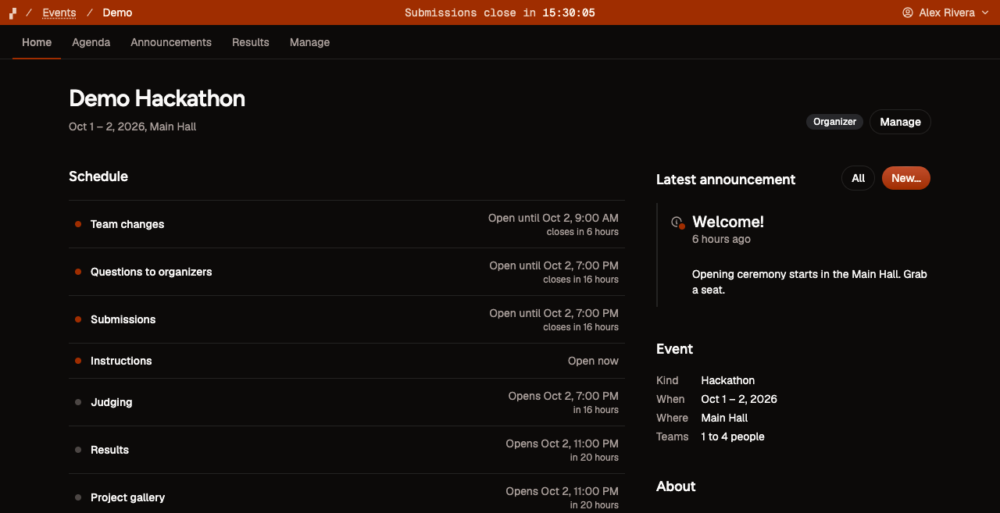
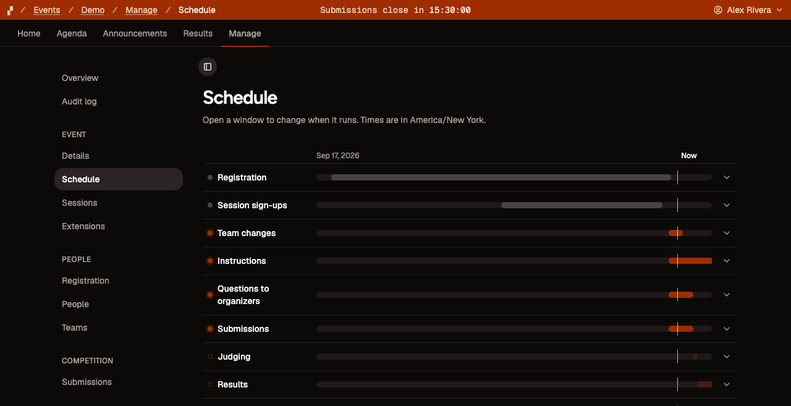

# Bogey

A self-hostable, extensible competition platform for everyone.

Built for hackathons, algorithm programming competitions, and anything else with entrants, deadlines and judging.

- **One app for everyone.** Participants register, form teams and submit; judges score from a queue;
  staff check people in; organizers run the event from **Manage**.
- **The whole event.** Registration with a waitlist and consent questions, check-in with badges and QR
  codes, an agenda people sign up for, prizes teams enter, rounds, expo tables, popular vote, awards with
  a full-screen reveal, certificates, exports, templates, and archives you can restore.
- **Judging that suits the room.** A weighted rubric with blind judging, conflicts and score normalization,
  or pairwise comparison, peer rating, ranked ballots, a points budget and scored leaderboards as plugins.
- **Teams that form themselves.** A board where people find teams and teams find people, and a matcher that
  proposes teams for everyone left over.
- **Contests too.** ICPC, IOI and code golf with a Docker runner, Kattis problem packages and a lockdown
  mode; CTFs with dynamic scoring; machine-learning leaderboards.
- **Configurable windows (not toggles).** Registration, submissions, judging and results open and close on a schedule,
  and the database enforces it.
- **Open.** A read-only API, calendar and news feeds, webhooks, and public profiles, with sign-in by email,
  Google, GitHub, Microsoft, GitLab, Discord, Keycloak or company single sign-on.
- **Multi-tenancy.** Serve one organization on your own domain, or many on one instance (with a
  certificate per hostname).
- **Extensible.** Formats, languages, GitHub and more are plugins you install separately.





## Quick start

You need [Node.js](https://nodejs.org/en/download) 22.18 or newer ([NTS](https://nodejs.org/learn/typescript/run-natively)), [Vite+](https://viteplus.dev) (`vp`, with pnpm as the recommended package manager) and, on a server, Docker (if self-hosting).

Check out [Getting started](docs/getting-started.md#you-need) ([wiki](https://github.com/0xethen/bogey/wiki/getting-started)) for the full list and instructions.

On a server (Supabase, Bogey and Caddy together):

```sh
git clone https://github.com/0xethen/bogey && cd bogey
vp install
vpr bogey setup --all-in-one --host hack.example.com --out deploy/all-in-one   # every secret in one .env
cd deploy/all-in-one && docker compose up -d
docker compose exec web bogey org init --org acme --name "Acme Hacks" --owner you@acme.org --host hack.example.com
```

To try it on your machine:

```sh
git clone https://github.com/0xethen/bogey && cd bogey
vp install
vpr bogey setup        # writes .env, then creates your first organization
vpr bogey seed demo    # optional: try out demo hackathon to look around in
vpr dev
```

[Getting started](docs/getting-started.md) has the details, and
[Self-hosting](docs/self-hosting.md) covers the all-in-one stack, Supabase Cloud, email and domains. All
docs are in [`docs/`](docs/Home.md), also published as the [project wiki](https://github.com/0xethen/bogey/wiki).

<!-- TODO: replace this wiki link with your fork's repository page! -->

## FAQ

**Why not Devpost (or similar)?** Bogey isn't a replacement for those platforms: hosted
platforms take a lot less setting up and are more social. Bogey is for when you want
to own the platform and its data, or need something they don't provide (or that we do better).

**Is it an SDK I can plug into my own UI?** Not technically. Bogey is a full-stack app
meant to be forked and (optionally) modified from source. It's very easy to style Bogey, however.
Additionally, the packages in `packages/` could be reused, but that isn't supported.

**Is it only for hackathons?** No. Hackathons are the core; programming contests, CTFs, game jams,
pitch competitions, science fairs, writing contests and class assignments run through settings and
plugins. [Formats](docs/guides/formats.md) lists a setup for each.

**Do I _have_ to self-host?** It's recommended, but no. You can use one of the many "free" hosting
providers available for the website, and Supabase has an awesome free tier you can use to get
started with Bogey (make sure to use a _different_ mailing service than Supabase's default).
For small hackathons, this may be a better option.

## License

Apache-2.0. See [LICENSE](LICENSE) and [NOTICE](NOTICE).

## Thanks

Devpost (hackathons), DOMjudge (contests), dribdat (open hackathons), CTFd, Gavel, and Kaggle for
inspiration

Plugin authors

You!

<!-- > Learn more about Good Software and the Good Software Pledge at [ethen.app/gsp](https://ethen.app/gsp). -->
