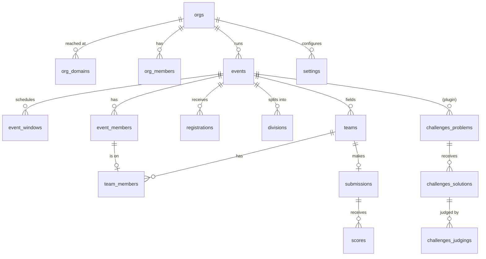

# Data model

This is the database schema for Bogey 2. The source of truth is
`supabase/schemas/*.sql`; this page explains the design behind it. For the
vocabulary, see [`CONTEXT.md`](../../CONTEXT.md). For who can read and write
what, see [security-model.md](security-model.md).

## Conventions

- **Schemas.** Tables and the RPCs clients may call live in `public`.
  Helpers used by RLS policies and triggers live in `private`, which is
  never exposed through the Data API ([ADR 0002](../adr/0002-schema-layout.md)).
  Tables owned by a plugin are named `<plugin>_*` and exist only when the plugin is
  installed; their SQL lives in the plugin's `migrations/`, applied by
  `bogey plugins migrate` ([ADR 0009](../adr/0009-plugins-ship-separately.md)).
- **Keys.** Entities get `id uuid primary key default gen_random_uuid()`.
  High-volume logs (`audit_log`, `judging_runs`) use
  `bigint generated always as identity`. Natural keys such as slugs and
  window keys are `unique` constraints, never primary keys, so renaming one
  never cascades.
- **Tenancy chain** ([ADR 0001](../adr/0001-tenancy.md)):
  - Every row reaches exactly one org through a chain that never changes.
  - Org-level tables carry `org_id`.
  - Event-level tables carry `event_id`; an event's `org_id` is immutable.
  - Deeper tables repeat their parent's `event_id` and use a **composite
    foreign key** such as `(event_id, team_id) → teams(event_id, id)`. That
    makes a copied column that disagrees with its parent impossible.
- **Timestamps.**
  - Every table has `created_at timestamptz not null default now()`.
  - Tables whose rows are edited also have `updated_at`, maintained by the
    single trigger `private.touch_updated_at()`.
  - Point-in-time facts use a `*_at` name: `submitted_at`, `checked_in_at`,
    `published_at`.
- **Enums vs text.**
  - A closed set that core owns is a Postgres enum.
  - A set that plugins extend is `text` with a format check. Window keys and
    permission names are examples.
  - Free text is never used as a status.
- **JSONB** only where the shape is defined by the user or by a plugin,
  such as registration answers, custom submission fields or setting values.
  It is validated on write by the RPC that writes it, against a Zod schema
  or a stored form definition.
- **Soft delete** only where the audit trail needs the row: `announcements`
  and `clarification_messages`, through `deleted_at`. Everything else is a
  real delete that cascades.
- **Indexes.** Every foreign key and every column that RLS filters on is
  indexed. The indexes are listed next to each table in the schema files.

## Overview

## Identity and tenancy

| Table              | Key columns                                                                                                                                                                                                                             | Notes                                                                                                                                                                                                                                                                                                         |
| ------------------ | --------------------------------------------------------------------------------------------------------------------------------------------------------------------------------------------------------------------------------------- | ------------------------------------------------------------------------------------------------------------------------------------------------------------------------------------------------------------------------------------------------------------------------------------------------------------- |
| `orgs`             | `slug citext unique`, `name`, `status org_status` (`active`, `restricted`, `suspended`)                                                                                                                                                 | The tenant.                                                                                                                                                                                                                                                                                                   |
| `org_domains`      | `hostname citext primary key`, `org_id`, `is_primary`, `verified_at`                                                                                                                                                                    | Maps a Host header to an org. Covers subdomains of the instance domain and custom domains.                                                                                                                                                                                                                    |
| `org_members`      | `(org_id, user_id)` primary key, `role org_role` (`owner`, `admin`, `member`), `invited_by`                                                                                                                                             | A user can belong to many orgs.                                                                                                                                                                                                                                                                               |
| `platform_admins`  | `user_id` primary key                                                                                                                                                                                                                   | Operators of the instance. Nobody else can write here, and platform admins bypass nothing in RLS except instance settings and org creation.                                                                                                                                                                   |
| `profiles`         | `id → auth.users`, `display_name`, `handle citext unique`, `avatar_path`, `timezone`, `locale`, `theme theme_pref` (`system`, `light`, `dark`), `bio_md`, `pronouns`, `links jsonb` (`[{ kind, url }]`), `visibility` (`org`, `public`) | Global per user and **not** scoped to an org. Other users can read a profile only if they share an org with that user. The portfolio page `/@<handle>` (off unless `accounts.portfolios` is on) is served by `public_profile`, which shows public profiles to anyone and the rest to people who share an org. |
| `user_preferences` | `(user_id, namespace, key)`, `value jsonb` (4 KB cap)                                                                                                                                                                                   | Personal UI state, such as editor tab size. Only the user can read it.                                                                                                                                                                                                                                        |

When there is no host match, the org falls back to the instance setting
`tenancy.defaultOrg`. That setting is explicit; it is never "the only org
there is".

## Settings and secrets

**Settings** ([ADR 0003](../adr/0003-settings.md)):

- **`settings`**: `id`, `scope setting_scope` (`instance`, `org`, `event`),
  `org_id?`, `event_id?`, `namespace`, `value jsonb`, `locked_keys text[]`,
  `updated_by`, `updated_at`.
- A check constraint ties `scope` to which ids are set.
- It is unique on `(scope, org_id, event_id, namespace)` with nulls treated
  as equal.
- Core namespaces:
  - `branding`
  - `registration`
  - `tenancy`
  - `ui`
  - `audit`
  - `teams`
  - `submissions`
  - `judging`
- Each plugin gets a namespace named after its key.
- The event row's value wins over the org row, and the org row over the
  instance row. The exception is a key that a higher scope lists in
  `locked_keys`.
- Plugin enablement is also a setting in the `plugins` namespace:
  - At event scope, `{ "enabled": ["challenges", ...] }` lists the plugins
    that are on for the event.
  - At org scope, `{ "available": [...] }` optionally limits which plugins
    the org's events may turn on. Leaving it out allows all of them.
  - RLS reads both through `private.plugin_enabled(event_id, key)`.
- The `registration` namespace has two keys with different jobs:
  - `signup` (`open`, `invite` or `closed`) is org-level. It is checked by
    the Before User Created hook.
  - `mode` (`open`, `review` or `invite`) says how an event handles
    self-registration. An org can set a default that its events inherit.

**Secrets:**

- **`secrets`**: `id`, `scope`, `org_id?`, `event_id?`, `name`,
  `vault_secret_id → vault.secrets`, `updated_by`, `updated_at`.
- Written through the `set_secret` RPC, which is organizer-only. Values are
  never returned to clients.
- Read only inside `private` functions (for example the Discord plugin's job,
  through `pg_net`) or with the service role.

## Events and schedule

**`events`:**

| Column                           | Type / values                                     |
| -------------------------------- | ------------------------------------------------- |
| `org_id`                         | never changes                                     |
| `slug`                           | `citext`, unique per org                          |
| `name`, `short_name`             |                                                   |
| `kind`                           | `event_kind`: `hackathon`, `contest`, `custom`    |
| `timezone`                       | an IANA name, checked against `pg_timezone_names` |
| `starts_at`, `ends_at`           |                                                   |
| `location`, `website_url`        |                                                   |
| `visibility`                     | `event_visibility`: `draft`, `unlisted`, `public` |
| `team_size_min`, `team_size_max` | `team_size_max = 1` means solo                    |
| `created_by`                     |                                                   |

**`event_windows`** ([ADR 0004](../adr/0004-windows-and-stages.md)):

- Columns: `(event_id, key)` unique, `opens_at?`, `closes_at?`,
  `override window_override?` (`open` or `closed`), `updated_by`.
- `private.window_open(event_id, key)`: an override wins; otherwise
  `opens_at <= now() < closes_at`, with a missing end treated as unbounded;
  a missing row means closed.
- Core keys: `registration`, `checkin`, `teams`, `submissions`, `judging`, `voting`,
  `results`, `gallery`, `instructions`, `sessions`.
- Plugin keys are prefixed, for example `challenges.contest`,
  `challenges.scoreboard`.

**Other event tables:**

- **`divisions`**: `event_id`, `name`, `description`, `sort`,
  `unique (event_id, name)`.
- **`tracks`**: `event_id`, `name`, `description_md`, `prize_md`, `sponsor_name?`,
  `sponsor_logo_url?`, `max_winners`, `opt_in` (teams may enter it; otherwise only
  organizers place entries), `form_id?` (the one submission form it applies to), `sort`.
  These are prizes. Organizers replace the list with `save_prizes`; teams enter
  submissions with `set_submission_tracks`, which applies `opt_in` and
  `submissions.maxTracks`.
- **`event_pages`**: `event_id`, `slug` (unique per event), `title`,
  `body_md`, `window_key?` (hidden until that window opens), `audience`
  (`members` or `public`), `sort`.

## People

**`event_members`:**

- Columns: `(event_id, user_id)` primary key, `role event_role`
  (`participant`, `staff`, `judge`, `organizer`), `division_id?` (composite
  foreign key to the event's divisions), `status member_status` (`active` or
  `removed`), `added_by`.
- **Org owners and admins act as organizers of every event in their org**
  without needing a row here.
- A trigger ensures an `org_members` row exists for every event member.

**`event_role_grants`:**

- Columns: `(event_id, user_id, role_key)`, where `role_key` is namespaced,
  for example `challenges.jury`.
- Plugin roles are granted on top of the member's core role.
- Composite foreign key to `event_members`.

**`roles`:**

- Columns: `key`, `label`, `source`. Core roles (`participant`, `staff`,
  `judge`, `organizer`) have plain keys and a null `source`; a plugin's roles
  are `<plugin>.<role>` with `source` set to the plugin key.
- The label is what the UI shows. `role_permissions.role_key` and
  `event_role_grants.role_key` reference `roles.key`.

**`role_permissions`:**

- Columns: `(role_key, permission)`, where `role_key` is a core role
  (`judge`) or a plugin role (`checkin.desk`).
- Core rows are seeded in the schema file; plugin rows are seeded in each
  plugin's schema file.
- `private.has_permission(event_id, permission)` returns true in either of
  two cases:
  1. The caller is an org owner or admin of the event's org.
  2. The caller's event role or a plugin grant maps to the permission.
- `bogey types` also generates the TypeScript `Permission` union from this
  table.

| Permission                                                                         | participant | staff | judge | organizer |
| ---------------------------------------------------------------------------------- | ----------- | ----- | ----- | --------- |
| `event.view`                                                                       | ✓           | ✓     | ✓     | ✓         |
| `event.compete` (team, submit)                                                     | ✓           |       |       |           |
| `people.view`                                                                      |             | ✓     |       | ✓         |
| `judging.score`                                                                    |             |       | ✓     | ✓         |
| `event.manage` (settings, windows, content, people, teams, judging, announcements) |             |       |       | ✓         |

**`registrations`** ([ADR 0006](../adr/0006-registrations.md)):

| Column                       | Notes                                                                 |
| ---------------------------- | --------------------------------------------------------------------- |
| `event_id`                   |                                                                       |
| `email`                      | `citext`, always lowercase                                            |
| `user_id?`                   | linked by a trigger when the account exists or is created             |
| `source`                     | `registration_source`: `import`, `link`, `self`, `invite`             |
| `invite_link_id?`            |                                                                       |
| `division_id?`               |                                                                       |
| `team_hint?`                 |                                                                       |
| `answers jsonb`              |                                                                       |
| `form_version`               |                                                                       |
| `status`                     | `registration_status`: `pending`, `approved`, `rejected`, `withdrawn` |
| `reviewed_by`, `reviewed_at` |                                                                       |

- `unique (event_id, email)`.
- When a row is approved **and** has a `user_id`, a trigger creates the
  `event_members` row.

**Related tables:**

- **`onboarding_forms`**: `event_id` primary key, `fields jsonb` (a
  versioned form definition), `version`. Each question has a `key`, `label`,
  `kind` (`text`, `longtext`, `select`, `multiselect`, `boolean`, `email`, `url`,
  `phone`, `date`, `number`, `consent`, `file`), `required`, and by kind `options`,
  `text` (what a consent question asks people to accept), `min` and `max`, plus an
  optional `showWhen` (`{ field, in }` or `{ field, ageUnder }`) that can point only at
  an earlier question. A trigger checks the shape; `register_for_event` runs every answer
  through `private.clean_registration_answers`, which skips hidden questions, stamps
  consent with the time and a SHA-256 of its text, and accepts a file only if the
  registrant uploaded it to their own folder of the `registrations` bucket.
- **`invite_links`**: `event_id`, `token` (unique, random), `label`,
  `auto_approve`, `capacity?`, `division_id?`, `opens_at?`, `closes_at?`,
  `disabled_at?`.
  - Anonymous visitors read a link only through `invite_link_view(token)`.

## Teams

- **`teams`**: `event_id`, `name`, `slug` (unique per event),
  `invite_code` (unique, random), `division_id?`, `locked_at?`,
  `created_by`.
- **`team_members`**: `event_id`, `team_id`, `user_id`, `role team_role`
  (`captain` or `member`).
  - `unique (event_id, user_id)` makes "one team per event" part of the
    structure, so no trigger is needed.
  - The composite foreign key `(event_id, team_id) → teams` keeps the team in
    the same event.
  - The composite foreign key `(event_id, user_id) → event_members` means
    only members can join.
  - A trigger enforces `team_size_max`, and also that the member's division
    matches when the team has one.
- **Solo events** (`team_size_max = 1`) get a team of one, created when the
  participant becomes an event member. Every competing table references
  `team_id`, so solo and team contests share one code path.

### Finding a team

The team board, on while the event setting `teams.board` is (`private.team_board_on`, which also needs
teams of more than one). Read through RPCs that check that and the caller; nobody selects other people's rows.

- **`team_seekers`**: `(event_id, user_id)` key, `skills[]`, `interests[]` (up to 12 labels of 30 characters,
  lowercased by `private.team_labels`), `timezone?`, `blurb`, `looking`. Readable directly only by the person and
  organizers; `team_board_people` lists those looking without a team.
- **`team_openings`**: one per team, `blurb`, `wanted[]`, `open`. `team_board_openings` lists open ones with room.
- **`team_requests`**: `direction` (`request` from a person, `invite` from a team), `message`, `status`
  (`pending`, `accepted`, `declined`, `withdrawn`), `created_by`; one pending per team and person. The captain
  answers a request, the invited person an invitation (`answer_team_request`); accepting inserts the membership
  (so `team_members`' checks apply), withdraws the person's other pending ones and is audited as
  `team.request_accepted`. Notifications `team.request`, `team.invited`, `team.answered`.
- **`team_matching_overview(event)`** and **`apply_team_matching(event, groups)`** (organizers): the matcher's
  input, and its proposal applied through `set_team_membership` in one step (`team.matched`). The matcher itself is
  `@bogey/utils/team-matcher`.

### Organizer roster tools

- **`import_roster(event, rows)`** adds approved registrations from a list of
  `{email, name?, team?, role?}`. It updates existing rows instead of
  duplicating them. People with accounts become members at once; the rest join
  on first sign-in, so an event can run with sign-ups turned off.
- **`registrations.team_hint`** puts a participant on the named team (created
  if needed, matched case-insensitively) as soon as their membership exists. A
  full team is skipped and noted in the audit log instead of failing sign-up.
- **`set_team_membership(event, user, team?)`** moves someone between teams, or
  off every team when `team` is left out, as one audited step that ignores the
  `teams` window.
- **`roster_overlaps(event)`** lists where this event's emails also registered
  in the org's other events, and whether the names differ. Registrations stay
  per event; nothing is merged.

## Notifications and the email outbox

- **`notifications`**: `user_id`, `org_id`, `event_id?`, `kind` (a core kind such as
  `registration.approved`, or `<plugin>.<kind>`), `title`, `body_md`, `link` (a path in the
  app), `read_at?`. People read, mark read and delete their own; only `private.notify` inserts.
  In the realtime publication.
- **`email_outbox`**: `org_id`, `event_id?`, `user_id?`, `to_email`, `kind` (an email template key),
  `vars jsonb` (strings for the template), `status` (`queued`, `sending`, `sent`, `failed`,
  `skipped`), `attempts`, `next_attempt_at` (the retry time, or the end of a `sending` row's ten
  minute lease), `last_error?`. No client policies. `public.email_outbox_claim` and
  `email_outbox_finish` are for the service role; `private.drain_email_outbox()` posts to the app
  every minute while mail is due, signed with the `bogey:email-drain` Vault secret.
- **`private.notify(users, event, kind, title, body, link, meta, email)`** writes the bell rows and
  queues email. A person's saved choice (`user_preferences`, namespace `notifications`, key
  `channels`) wins over the kind's default; a transactional kind's email can't be turned off. The
  defaults come from `packages/config/src/notifications.ts`, copied into SQL by `bogey db baseline`.

## Content and communication

- **`announcements`**: `event_id`, `title`, `body_md`, `severity`
  (`info`, `warning` or `urgent`), `everyone`, `publish_at`, `author_id`,
  `deleted_at?`. Posted through `post_announcement`, which writes the audience
  rows in the same transaction and audits it.
- **`announcement_audiences`**: who a post with `everyone = false` goes to. Each
  row is one `role`, `division_id`, `team_id` or `session_id`. A participant matches through
  their role, their team, their own division or their team's division; a session matches the
  people signed up for it and its hosts. Organizers always see every post. Only they can read
  these rows. Deleting a targeted team, division or session leaves the post with fewer readers,
  never more.
- **`announcement_reads`**: `(announcement_id, user_id)`, `read_at`.
- **`clarifications`** (conversations; "Messages" in the app):
  - Columns: `event_id`, `team_id?`, `asked_by`, `topic`
    (`general`, or a plugin topic such as `challenges.problem:<uuid>`),
    `subject`, `audience` (`organizers`, `judges` or `staff`), `status`
    (`open`, `answered` or `closed`), `visibility` (`private` or `public`).
  - Starting one and replying need the event's `chat` settings: `enabled` for
    anything, `participants` for participants, `judges` for participants to
    reach judges. `team_id` is set only with `copyTeam`.
  - Judges see `judges` and `staff` conversations; organizers see all.
  - `visibility = public` means the answer goes out to everyone.
- **`clarification_messages`**: `event_id`, `clarification_id` (composite
  foreign key), `author_id`, `author_role` (`participant`, `organizer` or
  `judge`, set by a trigger, never by the client), `body_md`, `deleted_at?`.

## Sessions

See [ADR 0010](../adr/0010-sessions.md). Every foreign key below is composite on `event_id`.

- **`session_slots`**: `event_id`, `name?`, `kind` (`everyone` | `choose`),
  `starts_at`, `ends_at?`.
- **`session_categories`**: `event_id`, `label`, `sort`. Shared by every slot.
- **`event_sessions`**: `event_id`, `slot_id`, `category_id?`, `kind` (free
  text: `talk`, `workshop`, `<plugin>.<kind>`), `name`, `description_md`,
  `location?`, `starts_at?`/`ends_at?` (null: the slot's), `host_note?`,
  `capacity?`, `required`, `takes_attendance`, `visibility` (`everyone` |
  `staff`), `sort`.
- **`session_hosts`**: `session_id`, `user_id` (an event member).
- **`session_signups`**: `slot_id`, `session_id`, `user_id`; one per
  choose-one slot, capacity enforced by trigger.
- **`session_attendance`**: `session_id`, `user_id`, `method` (`roster` |
  `code`), `marked_by`.
- **`session_codes`**: the check-in code per session; no policies, read only
  through `session_code()`.

Only select policies exist; writes go through `save_agenda`,
`choose_session`, `leave_session_slot`, `set_attendance`, `session_code` and
`check_in_session`.

## Hackathon submissions and judging

**Submissions:**

An event collects one or more deliverables. Each is a **form** with its own
window, so a hackathon can take a proposal early and a project at the end, and
a writing contest can take a single essay.

- **`submission_forms`**: `event_id`, `key`, `title`, `description_md`,
  `window_key` (the window that opens and closes it; `submissions` by default,
  or `submit-<key>` for its own), `judged`, `sort`. New hackathons start with a
  **Project** form (tagline, description, code, demo, video).
- **`submission_items`**: `form_id`, `key`, `label`, `help`, `kind`, `required`,
  `options jsonb?`, `config jsonb` (limits like `maxLength`, `accept`, `maxMb`,
  and `namesPeople` for items where teams may name themselves under blind
  judging),
  `sort`. Kinds: `text`, `longtext`, `markdown`, `url`, `video`, `file`,
  `drive`, `select`, `boolean`, `number`. Answer rules live in
  `@bogey/utils/answers`, shared by the browser and the server.
- **`submissions`**: `event_id`, `form_id`, `team_id` (`unique (form_id,
  team_id)`), `title`, `answers jsonb` (item key to value), `status` (`draft`,
  `submitted` or `disqualified`), `submitted_at`, `submitted_by`, `is_public`.
  - Status changes only through `submit_project`, which checks the form's
    window and its required items.
  - Drafts still open when a form's window closes are auto-submitted, if that
    setting is on, by `private.settle_submissions()` on `pg_cron`.
  - `is_public` puts a submitted project in the gallery. While a public
    event's `gallery` window is open (`private.gallery_open`), anyone can read
    those projects, their files (a storage policy), the event's forms and
    items, and team names.
- **`save_submission_form(event, form, items)`** creates or updates a form and
  replaces its items in one transaction.
- **`submission_tracks`**: `(submission_id, track_id)`, both same-event.
- **`submission_files`**: `submission_id`, `item_key`, `storage_path`,
  `file_name`, `size_bytes`, `caption`, `sort`. The Storage path is
  `submissions/<event>/<team>/<form>/<file>`, and the upload policy checks that
  form's window.

**Judging:**

Only submitted projects in forms marked `judged` are assigned and ranked, and
each form is ranked on its own. `save_criteria(event, items)` replaces the
criteria list in one audited transaction; removing a criterion deletes its
scores. `assign_round_robin` keeps existing assignments and counts only new
ones.

- **`criteria`**: `event_id`, `label`, `description_md`, `min_score`,
  `max_score` (`0 <= min_score < max_score <= 100`), `weight`, `sort`. Scores
  must fall in the range. Ranking maps the range to 0..1, clamped, so scores
  given before a range change still count sensibly.
  `rubric_id?` puts it in one rubric; without one it counts for every project.
- **`rubrics`**: `event_id`, `name`, `description_md`, `sort`. Saved with the criteria by
  `save_criteria(event, items, rubrics)`; removing one removes its criteria and their scores.
- **`submission_rubrics`**: `submission_id` (one per project), `rubric_id`, `set_by`. Written only
  by `set_submission_rubric`: organizers, judges who may score it while its round is open
  (`judging.judgeRubric`), or its team while it can edit the submission (`judging.teamRubric`).
  Ranking, `team_scores` and the gap check count only shared criteria and the picked rubric's.
- **`judging_flags`**: `submission_id`, `round_id`, `raised_by?`, `reason`, `gap?`, `resolved_at?`,
  `resolved_by?`, `resolution`. At most one open flag per project. Raised by `flag_submission`, or
  by a trigger on `scores` (no `raised_by`, `gap` set) once when two judges' complete totals differ
  by more than `judging.flagGap`; closed by `resolve_flag`. `private.may_deliberate` decides who
  sees flags and notes (`judging.deliberation`: the project's judges, every judge, or nobody, and
  never a conflicted judge); while a flag is open, `private.in_deliberation` opens the project's
  `scores` and `feedback` to them. `publish_results` refuses while flags are open unless
  `judging.holdFlagged` is off.
- **`deliberation_notes`**: `flag_id`, `author_id`, `body_md`. Written by `add_deliberation_note`
  on an open flag.
- **`judge_assignments`**: `event_id`, `judge_id` (composite foreign key to
  `event_members`), `submission_id`, `status` (`assigned`, `started` or
  `done`), `unique (judge_id, submission_id)`.
- **`scores`**: `event_id`, `submission_id`, `judge_id`, `criterion_id`,
  `value`, `unique (judge_id, submission_id, criterion_id)`.
  - A trigger sets `judge_id = auth.uid()` and checks
    `0 ≤ value ≤ max_score`.
- `submissions.table_label` is an expo table, set by organizers with `assign_tables` (teams can't
  change it). A judge's `skip_submission` sets their assignment's status to `skipped`.
- Team access to judges' output: `feedback` marked for the team is readable by the team only after
  publication and when `judging.shareWithTeams` allows; `team_scores` returns per-criterion averages
  under `shareWithTeams = scores`.
- **`votes`**: `(voter_id, submission_id)` for the popular vote. Written only by `cast_vote`
  (voting window, `voting.who`, vote cap, own-team rule, network limit) and `retract_vote`; people
  read their own, and `vote_counts` decides who sees the totals.
- **`judge_conflicts`**: `(judge_id, team_id)`, `reason`. Written by `declare_conflict` (a
  judge) and `set_conflicts` (organizers); scores from a judge for that team are left out of
  `private.rank_submissions`, which also evens out each judge's scores per
  `judging.normalize` and reports `raw_score` beside `score`.
- **`judging_rounds`**: `event_id`, `form_id`, `ordinal`, `name`, `window_key?`. Round 1 is
  created with the form and holds every submitted entry. **`round_entries`**
  (`round_id`, `submission_id`) lists the entries advanced into later rounds, written by
  `advance_submissions`. A submission is judged in the latest round it is in
  (`private.active_round`); `judge_assignments`, `scores` and `feedback` each carry that
  `round_id`, set by a trigger, and `criteria.round_id` limits a criterion to one round.
  Scoring needs the round's window (`private.round_window_open`), else the judging window.
- **`feedback`**: `event_id`, `submission_id`, `judge_id`, `body_md`,
  `visibility` (`judges` or `team`).
- **`awards`**: the drafted awards (`kind` of `overall`, `division`, `track`, `popular` or
  `special`, `label`, `place?`, `submission_id`, and the form, prize or division it came from).
  Organizer-only; written by `save_awards`. `publish_results` copies them, with the project,
  team and prize details of the day, into the publication's `awards`.
- **`result_publications`**: `event_id`, `published_at`, `published_by`, `awards`,
  `rows jsonb`.
  - The rows are a snapshot of the ranking, computed by `private.rank_submissions(event)`
    at publish time.
  - The newest publication is what participants see.

## Plugin tables: challenges

Plugin-owned; `challenges` ships with Bogey (`packages/plugins/bundled`) and `bogey db migrate` applies its tables. Enabled per event through the `plugins` setting. Contest configuration
(scoring model, penalty, freeze time, allowed languages, attempt limit) is the
`challenges` settings namespace, not a separate table.

**Languages and problems:**

- **`challenges_languages`** (instance catalog): `key` primary key, `name`,
  `version`, `image`, `source_file`, `compile_cmd?`, `run_cmd`,
  `editor_mode`, `enabled`.
- **`challenges_problems`**:

  | Column                                                | Notes                                  |
  | ----------------------------------------------------- | -------------------------------------- |
  | `event_id`                                            |                                        |
  | `label`                                               | A, B, ...; unique per event            |
  | `slug`, `title`                                       |                                        |
  | `statement_md`                                        |                                        |
  | `statement_pdf_path?`                                 |                                        |
  | `time_limit_ms`, `memory_limit_mb`, `output_limit_kb` |                                        |
  | `checker`                                             | `exact`, `tokens`, `float` or `custom` |
  | `checker_tolerance?`                                  |                                        |
  | `checker_source?`                                     |                                        |
  | `points`                                              | used for IOI scoring                   |
  | `visible`                                             |                                        |
  | `sort`                                                |                                        |

- **`challenges_testcases`**: `event_id`, `problem_id`, `ordinal`,
  `is_sample`, `group_key?`, `points?`, `input text`, `answer text`.
  - Size is capped by a check constraint.
  - Participants have **no** policy on this table; samples come from the
    `challenges_problem_samples(problem_id)` RPC while the contest window is open.
- **`challenges_attachments`**: `event_id`, `problem_id`, `name`,
  `storage_path`.

**Solutions and judgings:**

- **`challenges_solutions`**:
  - Columns: `event_id`, `problem_id`, `team_id`, `user_id`,
    `language_key`, `source text`, `submitted_at`.
  - It has **no insert policy**: the `challenges_submit()` RPC checks the
    window, whether the language is allowed, team membership, the attempt
    limit and the lockdown requirement. It then inserts the solution and
    queues a judging.
- **`challenges_judgings`**:

  | Column                         | Notes                                                   |
  | ------------------------------ | ------------------------------------------------------- |
  | `event_id`, `solution_id`      |                                                         |
  | `status`                       | `queued`, `running`, `done`, `failed`                   |
  | `runner_id?`                   |                                                         |
  | `lease_expires_at?`            |                                                         |
  | `attempts`                     |                                                         |
  | `verdict?`                     | `challenges_verdict`: AC, WA, TLE, MLE, RE, CE, OLE, JE |
  | `score?`                       |                                                         |
  | `max_time_ms`, `max_memory_kb` |                                                         |
  | `compile_output?`              |                                                         |
  | `valid`                        | a rejudge marks older judgings invalid                  |
  | `started_at`, `finished_at`    |                                                         |

  See [ADR 0007](../adr/0007-judging-pipeline.md).

- **`challenges_judging_runs`**: `judging_id`, `testcase_id`, `verdict`,
  `time_ms`, `memory_kb`, `output_excerpt?` (samples only).
  - Readable by jury only, except sample rows of your own team.
- **`challenges_scoreboard(event, jury)`**: a SQL function returning one
  row per team plus per-problem cells (attempts, first-AC time,
  pending-after-freeze).
  - It uses ICPC or IOI scoring from settings.
  - `as_jury` requires `challenges.jury`.

## Plugin tables: lockdown

Plugin-owned; present when the plugin is installed.

- **`lockdown_sessions`**: `event_id`, `user_id`, `started_at`,
  `heartbeat_at`, `extension_version?`, `attested_at?`, `violations int`,
  `locked_at?`.
  - Written only through `lockdown_heartbeat()` and
    `lockdown_violation()`.
  - The individual signals go to the audit log.

## Check-in

- **`checkins`**: `(event_id, user_id)`, `checked_in_at`, `checked_in_by`, `method`
  (`desk`, `qr`, `self`, `import`), `checked_out_at?`, `note`. One row per person; checking in
  again after leaving clears `checked_out_at`. Staff with `people.checkin` read every row;
  people read their own. Written only by `check_in`, `undo_check_in`, `check_out` and
  `check_in_walk_in`, which audit.
- **`member_codes`**: `(event_id, user_id)` and a random eight character `code` (no 0, 1, I or
  O), made when a person first opens their badge. No policies: read through `my_badge`, the
  desk's `check_in` lookup and `badge_sheet`.
- **`badge_emails`**: who has been sent their badge, so the hourly job sends it once.
- `private.check_in_ok(event)` is true unless `checkin.requiredToCompete` holds back participants
  who haven't checked in; team changes, submission writes and votes call it.
- The venue code for self check-in is not stored: `private.venue_code` derives it from a Vault
  secret and the ten-minute period, and `check_in` accepts the current and previous one.

## Public API support

- **`calendar_tokens`**: `user_id` primary key, `token_hash` (sha-256 of the `bgc_...` token, which is shown once),
  `created_at`, `last_used_at`. A person reads only their own row. `create_calendar_token` and `revoke_calendar_token` are the
  only writers; `calendar_feed(token)` is callable without a session and returns the owner's signed-up and hosted sessions and
  their events' windows.
- **`public_announcements(event)`**: announcements meant for everyone on a public event, for signed-out readers of the feeds.
- **`webhooks`**: `org_id`, `event_id?` (null: every event), `url` (https, a public name), `events text[]` (of nine kinds),
  `disabled_at?`. Org admins manage all of an org's; event managers their event's. **`webhook_secrets`** holds the signing
  key with no policy; it is returned once by `create_webhook` and `rotate_webhook_secret`.
- **`webhook_deliveries`**: `webhook_id`, `kind`, `payload`, `status` (`queued`, `sending`, `sent`, `failed`), `attempts`,
  `request_id` (the `pg_net` request), `response_status`, `last_error`, `next_attempt_at`. An `after insert` trigger on
  `audit_log` queues a delivery for each webhook that wants the entry's kind (`private.webhook_kind` maps actions to kinds);
  `private.deliver_webhooks()` settles earlier sends from `net._http_response` and sends what is due.
- **`event_archive_people(event)`**: the members' emails for an archive; org admins and the service role only.

## Certificates

- **`certificate_templates`**: `org_id`, `event_id?` (null: the organization's wording), `kind` (`participation`, `award`,
  `judge`, `volunteer`), `body_md`, `orientation`, `background_url?`. One per event and kind, and per org and kind.
- **`certificates`**: `event_id`, `user_id`, `kind`, `award_id?`, `label`, `recipient_name` (as it was when issued), a
  ten-character `code` (unique), `issued_by`, `issued_at`, `revoked_at?`. A person reads their own, organizers all of the event's.
- Written by `claim_certificate` (the caller, if `private.certificate_options` says they qualify: checked in or submitted,
  awards once results are published, a judge or staff role, and `certificates.enabled`), `issue_certificates` (organizers, for
  everyone, notifying them) and `revoke_certificate`. `verify_certificate(code)` is callable without a session.

## Audit

**`audit_log`**:

- Columns: `id bigint identity`, `org_id`, `event_id?`, `actor_id?`,
  `action`, `target_type?`, `target_id?`, `meta jsonb` (4 KB cap),
  `created_at`.
- Rows are inserted by `private.audit()` (or `private.audit_org()` for org
  entries) from inside RPCs and triggers. Triggers cover tables people edit
  directly: `events` (`event.updated`, with old and new values of short
  fields only), `settings` (`settings.changed`, with the keys that changed,
  never their values), `event_members` role changes and removals, `teams`
  renames, locks and deletes, `submission_forms` deletes and `org_members`.
  They log only writes made with a session, so org init and demo seeding
  stay quiet.
- `CORE_ACTIONS` in `packages/db/src/audit.ts` lists every core action, generated
  from the schema's `private.audit()` calls (`bogey types --schema`); `ACTION_LABELS`
  must label each one or type checking fails.
- Client-side signals, such as lockdown or `ac.*` events, go through
  `log_event()`. It checks that the caller is a member of the event it
  names, and that the action is either core or belongs to a plugin enabled
  for that event.
- Retention comes from the `audit` setting at org scope, and a `pg_cron` job
  prunes old rows.

## Storage buckets

Every object path starts with the id that scopes it, and the bucket's
policies check that prefix. `branding` is scoped by `<org_id>/`, and the
other buckets by `<event_id>/`. Every event belongs to exactly one org, so
this still keeps orgs apart.

| Bucket          | Public | Contents                                                                                                                                 |
| --------------- | ------ | ---------------------------------------------------------------------------------------------------------------------------------------- |
| `branding`      | read   | org logos and icons                                                                                                                      |
| `submissions`   | no     | submission files; readable by the team, judges and organizers                                                                            |
| `attachments`   | no     | problem PDFs and attachments; readable while the contest window is open                                                                  |
| `registrations` | no     | files answering registration questions, in `<event_id>/<user_id>/`; readable by the registrant and people who can see the event's people |

## Scheduled jobs (`pg_cron`)

- **`private.settle_submissions()`**, every minute: auto-submits drafts
  whose window has closed.
- **`private.announce_window_changes()`**, every minute: audits windows that
  just opened or closed (`window.opened`, `window.closed`), which plugins like
  Discord watch.
- **`private.prune_audit_log()`**, daily.
- **`private.drain_email_outbox()`**, every minute: wakes the app when mail is due.
- **`private.prune_notifications()`**, daily: drops old sent mail and notifications.
- **`private.deliver_webhooks()`**, every minute, and **`private.prune_webhook_deliveries()`**, daily (30 days).
- **`private.challenges_expire_leases()`**, every minute: requeues judgings
  whose runner lease has expired, and marks JE after too many attempts.
